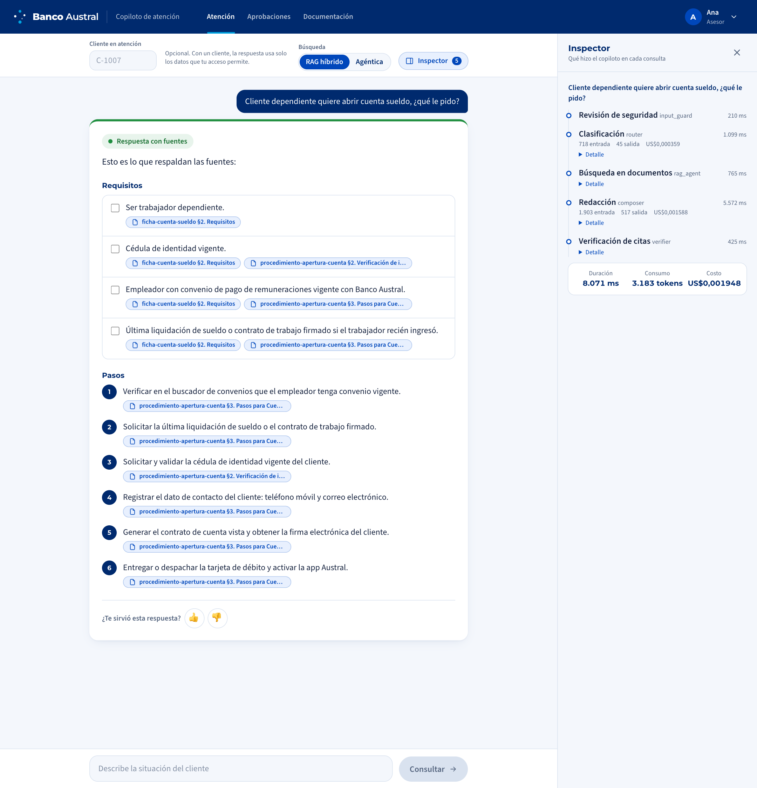
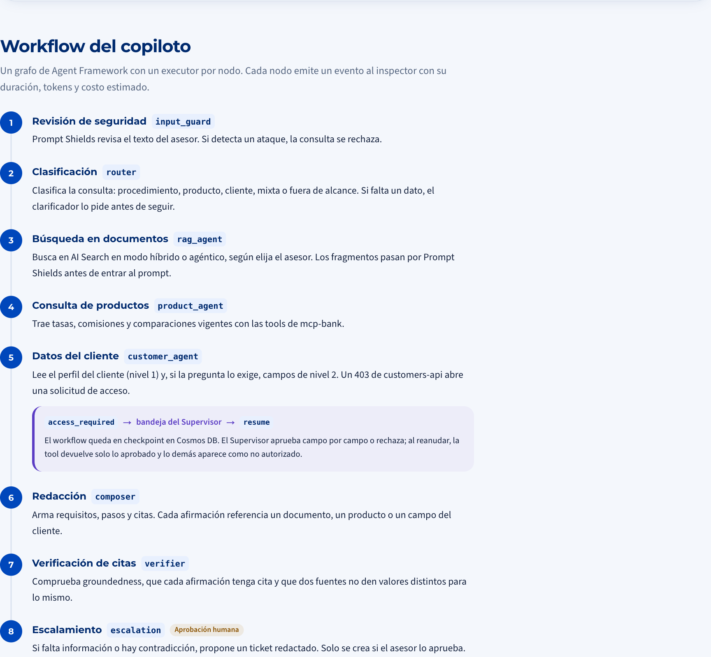
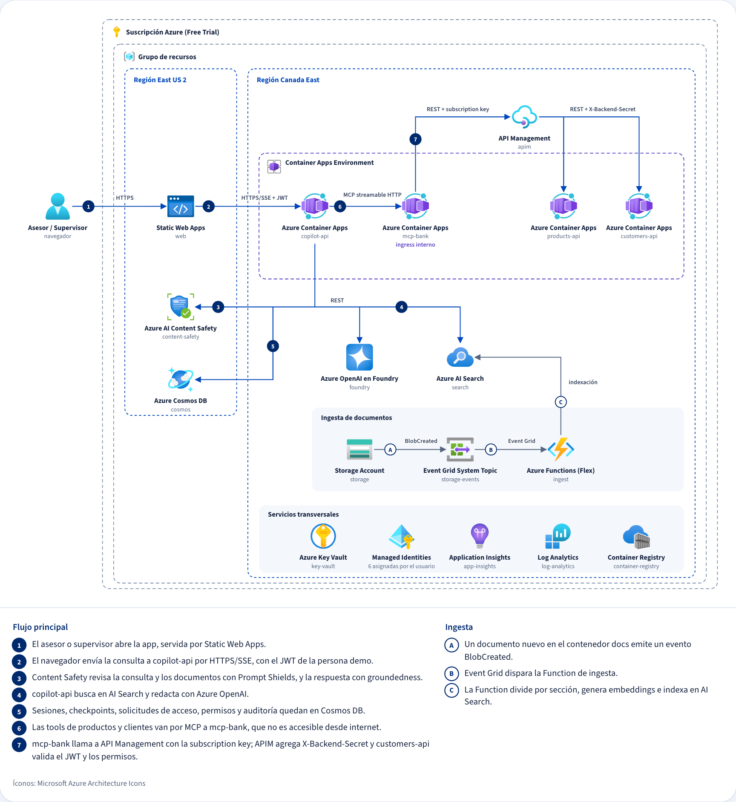

# Banco Copilot Azure

Copiloto para asesores de un banco ficticio, **Banco Austral**: responde con requisitos, pasos y la fuente
de cada dato, y solo usa datos de un cliente cuando un Supervisor lo autoriza. Corre en Azure con
servicios que escalan a cero.

**En vivo:** [azure.cuisangelo.com](https://azure.cuisangelo.com) · **Arquitectura y recursos:**
[azure.cuisangelo.com/documentacion](https://azure.cuisangelo.com/documentacion)



## Producto

Un asesor de sucursal atiende a un cliente en vivo y necesita saber qué pedirle, qué pasos seguir y si
el cliente califica, sin buscar en diez documentos ni equivocarse con una circular vigente.

- **Responde con fuentes.** Cada requisito y cada paso cita el documento, el producto o el dato del
  cliente que lo respalda. Lo que no tiene respaldo se descarta, no se inventa.
- **Pregunta cuando falta un dato** y **escala** con un ticket redactado cuando no hay respuesta o las
  fuentes se contradicen. El ticket solo se crea si el asesor lo aprueba.
- **Datos del cliente por niveles.** El perfil básico (nivel 1) está disponible para el asesor; la renta,
  la deuda o el comportamiento de pago (nivel 2) exigen un permiso por campo, aprobado por un
  Supervisor distinto y que vence en 30 minutos. El nivel 3 no existe en ningún modelo.
- **Muestra cómo llegó a cada respuesta:** un inspector con cada paso, su duración, tokens y costo.

No aprueba ni ejecuta operaciones, no da asesoría al cliente final y no responde fuera del dominio del
banco. Las personas (Ana y Bruno, asesores; Sofía, supervisora) y todos los datos son sintéticos.

## Solución

Cada consulta recorre un workflow de **Microsoft Agent Framework**: un grafo con un executor por paso, en
el que los modelos deciden *qué* hacer y el código decide *si está permitido*.



1. **Revisión de seguridad:** Prompt Shields revisa la consulta.
2. **Clasificación:** el router elige la ruta y reescribe la consulta con el contexto de la conversación.
3. **Búsqueda:** AI Search en modo híbrido (BM25 + vectores + reranking semántico) o agéntico (la
   knowledge base planifica subconsultas). Los fragmentos pasan por Prompt Shields.
4. **Productos y cliente, en paralelo:** dos agentes planifican qué tools de MCP llamar; los datos de
   nivel 2 sin permiso abren una solicitud y el workflow queda en pausa hasta la decisión del Supervisor.
5. **Redacción** de requisitos y pasos, cada afirmación con su cita.
6. **Verificación:** groundedness por afirmación, citas obligatorias y detección de contradicciones
   entre fuentes.
7. **Escalamiento** con aprobación humana cuando falta respaldo.

## Arquitectura



| Pieza | Servicio | Por qué |
|---|---|---|
| Web | Static Web Apps (Next.js estático) | Gratis, dominio propio, login integrado para la vista del autor |
| `copilot-api` | Container Apps (FastAPI, SSE) | El workflow; transmite cada paso al navegador mientras ocurre |
| `mcp-bank` | Container Apps, solo ingreso interno | Servidor MCP con 5 tools de productos y clientes |
| `products-api`, `customers-api` | Container Apps detrás de API Management | APIM pone la clave de suscripción y el secreto de backend; `customers-api` valida el JWT y los permisos |
| Modelos | Azure OpenAI en Microsoft Foundry | gpt-4.1-mini y text-embedding-3-small; evaluaciones en el proyecto de Foundry |
| Búsqueda | Azure AI Search | Índice `bank-docs`; un servicio Basic aparte para el modo agéntico, encendido solo en demos |
| Guardrails | Azure AI Content Safety | Prompt Shields y groundedness |
| Estado | Cosmos DB (free tier) | Sesiones, checkpoints del workflow, solicitudes, permisos con TTL y auditoría |
| Ingesta | Storage + Event Grid + Functions (Flex) | Un documento nuevo se divide por sección, se vectoriza y se indexa |
| Transversal | Key Vault, Managed Identity, Application Insights, Log Analytics, Container Registry | Identidades en vez de llaves; trazas OpenTelemetry de punta a punta |

## Detalles técnicos

- **Sin secretos en la configuración.** Los servicios se llaman entre sí con identidades administradas y
  el mínimo rol (Cosmos, AI Search y Storage tienen las llaves desactivadas); las únicas credenciales,
  la clave de APIM, el secreto de backend y la clave que firma los tokens, viven en Key Vault.
- **El acceso a datos lo decide una API, no el modelo.** Aunque un prompt fallara, `customers-api`
  responde 403 sin un permiso vigente; los valores de nivel 2 nunca entran al historial ni a la
  telemetría.
- **Pausas que sobreviven reinicios.** La espera por el Supervisor es un checkpoint del workflow en
  Cosmos, cargado con un unpickler restringido a los tipos del workflow.
- **Personas demo con JWT RS256** firmados por `copilot-api`: los visitantes no tienen cuenta en el
  tenant, y cambiar a Entra ID cambiaría el emisor, no la autorización.
- **Evaluación con datos:** 40 preguntas etiquetadas (respondibles, de cliente con y sin permiso, sin
  respuesta, contradicciones, fuera de alcance, inyecciones) con métricas deterministas, jueces de
  Foundry y una regla que hace fallar la corrida si se filtra un dato protegido. Cada cambio de prompt se
  acepta o se revierte con la evaluación completa.
- **Infraestructura como código:** Terraform (azurerm + azapi) con tests de invariantes de seguridad y
  costo; GitHub Actions despliega con OIDC, sin secretos de Azure en el repositorio.
- **FinOps:** tiers gratuitos donde existen, escalado a cero, tope diario de tokens en la API y alertas
  de presupuesto.
- **Repositorio público sin identificadores.** El build falla si el bundle público o un archivo
  versionado contiene la suscripción, el tenant o un nombre de recurso; el inventario real solo se sirve
  al autor, con sesión iniciada.

## Estructura

```
services/copilot-api     workflow, guardrails y API (FastAPI)
services/mcp-bank        servidor MCP
services/products-api    productos vigentes
services/customers-api   clientes, permisos y auditoría
functions/ingest         ingesta a AI Search
packages/contracts       modelos compartidos
web                      Next.js
infra                    Terraform
evals                    dataset, runner y reporte
```

Diseño en [`docs/superpowers/specs`](docs/superpowers/specs/2026-10-11-banco-copilot-design.md), plan en
[`docs/superpowers/plans`](docs/superpowers/plans/2026-10-11-banco-copilot.md) y bitácora del proyecto
en [`docs/bitacora.md`](docs/bitacora.md).

## Tests (sin Azure)

```sh
uv run --all-packages pytest      # backend, evaluaciones, función de ingesta y contratos
pnpm -C web test                  # web
terraform -chdir=infra test       # invariantes de infraestructura, con providers simulados
```

## Correr en local

`copilot-api`, `mcp-bank` y la web corren en tu máquina; el modelo, AI Search, Content Safety, Cosmos y
los backends detrás de APIM son los desplegados, y todo se autentica con tu `az login`.

Requisitos: `uv`, `pnpm`, `az login` en la suscripción y un `terraform apply` hecho con tu usuario
(te da los roles de datos que usa la corrida local).

```sh
uv run python scripts/local_env.py bcopilot-rg   # escribe .env.local y web/.env.local desde lo desplegado
scripts/web_inventory.sh bcopilot-rg             # inventario de /documentacion
scripts/local.sh                                 # mcp-bank :8001, copilot-api :8000, web http://localhost:3000
```

- `.env.local` trae la clave de suscripción de APIM y la clave que firma los tokens de las personas: está
  en `.gitignore` y no se comparte.
- La API local usa la **misma base de Cosmos** que producción (una segunda base saldría del free tier):
  comparte sesiones, auditoría y el tope diario de tokens.
- Si cambia la configuración desplegada (por ejemplo, al encender o apagar el modo agéntico), vuelve a
  correr `local_env.py`.
